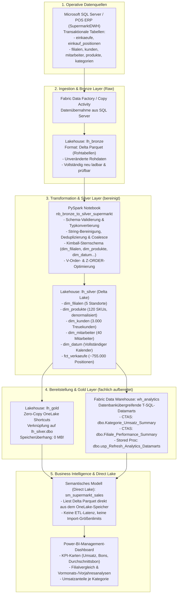

# 🛒 Supermarkt-Medallion-Datenplattform & Power BI Direct Lake
### End-to-End Lakehouse auf Microsoft Fabric (Portfolio-Projekt zur Vorbereitung auf DP-700 & PL-300)

[](https://learn.microsoft.com/fabric/)
[](https://spark.apache.org/)
[](https://learn.microsoft.com/fabric/data-warehouse/)
[](https://powerbi.microsoft.com/)
[](LICENSE)

---

## 📌 Übersicht & Geschäftskontext

Dieses Portfolio-Projekt dokumentiert eine End-to-End **Cloud-Datenplattform** für das fiktive deutsche Lebensmitteleinzelhandels-Unternehmen **FrischMarkt GmbH** (5 Filialen, 8 Warengruppen, 120 SKUs, ~755.000 Kassenbeleg-Positionen, synthetische Daten).

Ziel der Plattform ist die Überwindung traditioneller ETL- und Import-Grenzen: Operative Kassendaten werden über eine dreistufige **Medallion-Architektur (Bronze ➔ Silver ➔ Gold)** in **Microsoft Fabric** überführt, mit **PySpark** und **Delta Lake** qualitätsgesichert und über **Power BI Direct Lake** ohne Duplikation oder Datenaktualisierungs-Latenz für das Management bereitgestellt.

---

## 🏗️ End-to-End Architektur



---

## 📂 Repository-Struktur

```text
├── notebooks/
│   └── nb_bronze_to_silver_supermarkt.py   # PySpark-ETL: Bereinigung, Sternschema, Kalender & Delta Z-Order
├── sql_warehouse/
│   └── warehouse_analytics_ctas_sp.sql     # Fabric Data Warehouse: CTAS & Stored Procedures (datenbankübergreifend)
├── power_bi/
│   └── dax_measures_supermarkt.dax         # Explizite DAX-Measures (Zeitintelligenz, Vorjahresvergleich, Filial-KPIs)
├── .gitattributes                          # Linguist-Sprachzuordnung (TSQL, DAX, Python)
├── .gitignore
├── LICENSE                                 # MIT-Lizenz
└── README.md                               # Vollständige Dokumentation & Runbook
```

---

## 🛠️ Technische Kernkomponenten im Detail

### 1. PySpark & Delta Lake (Bronze ➔ Silver)
*Datei:* [`notebooks/nb_bronze_to_silver_supermarkt.py`](notebooks/nb_bronze_to_silver_supermarkt.py)
- **Denormalisierung & Sternschema:** Überführung flacher operativer Tabellen in ein analytisches Sternschema (`dim_filialen`, `dim_produkte`, `dim_kunden`, `dim_mitarbeiter`, `dim_datum`, `fct_verkaeufe`).
- **Datenhygiene:** Standardisierung von Zeichenketten (`trim`), Nullwert-Absicherung (`coalesce`) und deterministische Deduplizierung über Primärschlüssel.
- **Kalender-Generierung:** Automatische Erzeugung einer lückenlosen Datumstabelle (2024–2026) mit deutschen Wochentags- und Monatsnamen in PySpark für DAX-Zeitintelligenzfunktionen in Direct Lake.
- **Performance-Optimierung:** Anwendung von `OPTIMIZE` mit multidimensionalem `Z-ORDER BY (EinkaufDatum, FilialeID, ProduktID)` für beschleunigtes File-Skipping bei analytischen Abfragen.

### 2. Fabric Data Warehouse (datenbankübergreifendes T-SQL)
*Datei:* [`sql_warehouse/warehouse_analytics_ctas_sp.sql`](sql_warehouse/warehouse_analytics_ctas_sp.sql)
- **Zero-Copy Shortcuts:** Nahtloser SQL-Zugriff aus dem Warehouse `wh_analytics` auf den Lakehouse Delta Layer (`[lh_silver].[dbo].[fct_verkaeufe]`) ohne Datenverdopplung.
- **CTAS (CREATE TABLE AS SELECT):** Vorberechnete Aggregations-Tabellen für Vorstandspräsentationen und Fachbereichsanalysen (`dbo.Kategorie_Umsatz_Summary`, `dbo.Filiale_Performance_Summary`).
- **Idempotente Stored Procedures:** Automatisierte Aktualisierungsroutinen via `dbo.usp_Refresh_Analytics_Datamarts` für Pipeline-Orchestrierungen.

### 3. Power BI Direct Lake & DAX Engine
*Datei:* [`power_bi/dax_measures_supermarkt.dax`](power_bi/dax_measures_supermarkt.dax)
- **Direct-Lake-Modus:** Direkte Abfrage der Delta Parquet Dateien in OneLake ohne herkömmlichen Import und ohne DirectQuery-Performanceverluste.
- **Explizite Kennzahlen:**
  - `Total_Umsatz = SUM(fct_verkaeufe[Gesamtbetrag])`
  - `Durchschnittsbon = DIVIDE([Total_Umsatz], [Anzahl_Transaktionen], 0)`
  - `Total_Umsatz_Vorjahr = CALCULATE([Total_Umsatz], SAMEPERIODLASTYEAR('dim_datum'[Datum]))`
  - `Umsatz_YoY_Wachstum_Prozent = DIVIDE([Umsatz_YoY_Wachstum_Absolut], [Total_Umsatz_Vorjahr], 0)`

---

## 🧠 Architekturentscheidungen (DP-700- & PL-300-Leitfaden)

> [!NOTE]
> **Warum Direct Lake statt DirectQuery oder Import?**  
> Direct Lake lädt Parquet-Spaltendaten direkt aus OneLake in den VertiPaq-Hauptspeicher der Power-BI-Engine. Dadurch entfallen sowohl zeitaufwendige geplante Aktualisierungen (Import) als auch die langsame Übersetzung in SQL-Abfragen (DirectQuery).

> [!IMPORTANT]
> **Fallback vermeiden (Direct Lake ➔ DirectQuery):**  
> 1. **V-Order aktiv halten:** Gewährleistet native VertiPaq-kompatible Kompression in der Parquet-Datei.
> 2. **Keine berechneten Spalten in DAX:** Alle Transformationen und Spalten werden upstream in PySpark oder SQL ausgeführt.
> 3. **Kapazitätslimits überwachen:** Überschreitet die Modellgröße die Paging-Grenzen der Fabric-SKU, fällt Power BI automatisch auf DirectQuery zurück. Durch schlanke Datentypen (`INT`, `DECIMAL(10,2)`) und Z-Ordering bleibt das Modell dauerhaft im Direct-Lake-Modus.

---

## 🚀 Schritt-für-Schritt-Anleitung (Reproduktion)

1. **Arbeitsbereich anlegen:** Microsoft-Fabric-Arbeitsbereich mit Fabric- oder Testkapazität erstellen (`DP700_Supermarkt_Practice`).
2. **Lakehouses initialisieren:**
   - `lh_bronze`: Speicherort für unveränderte Rohdaten.
   - `lh_silver`: Bereinigter Delta Lake Layer mit Star Schema.
   - `lh_gold`: Gold Layer (Zero-Copy OneLake Shortcuts auf `lh_silver`).
3. **Warehouse anlegen:** `wh_analytics` für T-SQL-Abfragen und datenbankübergreifendes CTAS.
4. **Notebook ausführen:** `notebooks/nb_bronze_to_silver_supermarkt.py` im Fabric-Arbeitsbereich importieren und ausführen.
5. **Warehouse-Skript bereitstellen:** `sql_warehouse/warehouse_analytics_ctas_sp.sql` ausführen und Stored Procedure testen.
6. **Semantisches Modell konfigurieren:** Neues Direct-Lake-Modell auf `lh_gold` erstellen und DAX-Measures hinterlegen.
7. **Dashboard bereitstellen:** Power-BI-Management-Dashboard mit KPI-Karten, Treemaps und Monatsvergleichen veröffentlichen.

---

## 👤 Entwickler & Kontakt

**Alexander Fritzler**  
*Junior Data Engineer (Microsoft Fabric · Snowflake · SQL Server · PySpark)*  
- 💼 LinkedIn: [Alexander Fritzler | Profil anzeigen](https://www.linkedin.com/in/alexander-fritzler-214628356/)  
- 🐙 GitHub: [@alefritz19](https://github.com/alefritz19)  
- 📧 Kontakt: alefritz19@gmail.com
